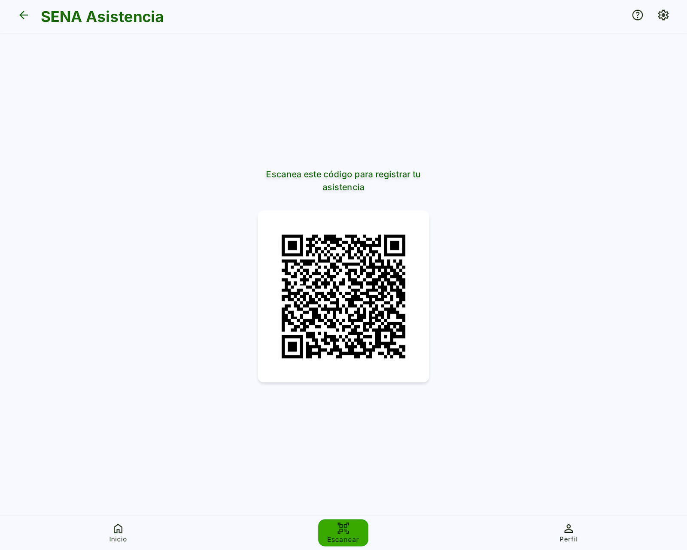
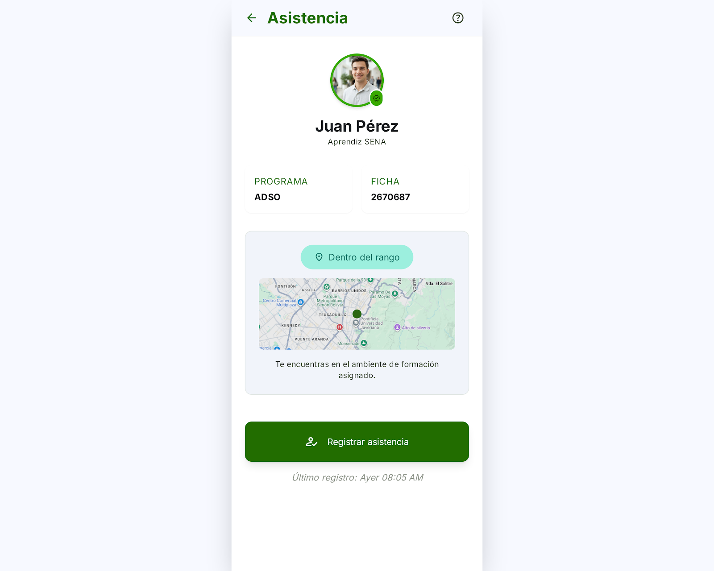
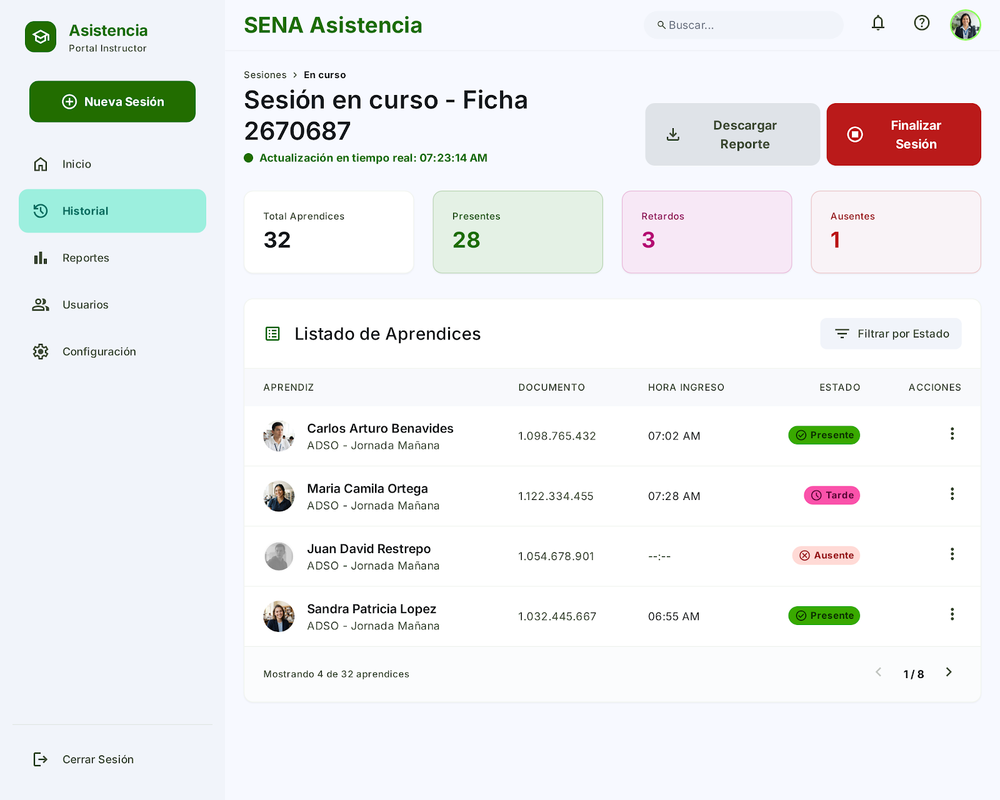

# Prototipo Inicial (Mockups) · Casos de Uso Críticos (SAB / BioSENA)

**Proyecto:** Sistema de Asistencia Biométrica (SAB / BioSENA) · **Referencia:** `SRS-SAB-001` (v2.3)  
**Autor:** `@pascuasjhorman-rgb`  
**Prototipo interactivo en línea oficial:** [https://biosena-asistencia-biom-trica.ai.studio/](https://biosena-asistencia-biom-trica.ai.studio/)  
**Base reutilizada del fork:** Diseños de interfaz desarrollados en `03-execute/17-week/02-optional-activity/sena_asistencia_.zip` y mockup de `03-execute/23-week/02-optional-activity/asistencia_sena_mockup.png`, adaptados para reflejar los casos de uso críticos de SAB sin exponer datos reales de terceros.

---

## 0. Prototipo Web Interactivo Oficial (BioSENA)

El equipo de desarrollo de SAB cuenta con una propuesta interactiva desplegada en:
👉 **[https://biosena-asistencia-biom-trica.ai.studio/](https://biosena-asistencia-biom-trica.ai.studio/)**

En esta plataforma se validan los flujos de interacción de los 3 roles del sistema:
- **Aprendiz:** Acceso por credenciales y ficha, visualización de sesiones activas, escaneo guiado de QR, ingreso de código manual y consulta de historial.
- **Instructor:** Apertura de sesiones asignadas, proyección del código QR rotativo con temporizador visual, supervisión de asistencias en tiempo real y registro de contingencia.
- **Superadmin:** Configuración de sedes, fichas, ambientes, horarios académicos y auditoría.

---

## 1. Pantalla 1 · `CU-05 Abrir sesión de asistencia y proyección de QR dinámico`
- **Caso de uso que atiende:** `CU-05 Abrir sesión` (soporte a `RF-SAB-018`, `RF-SAB-020`, `RF-SAB-021`, `RF-SAB-055`).
- **Actor:** Instructor líder.
- **Descripción:** Muestra la sesión de formación activa para la ficha, el temporizador de rotación de 15 segundos y la proyección del código QR seguro junto con el código numérico de contingencia para aprendices sin cámara disponible.
- **Archivo de imagen:** [`mockups/mock-cu05-sesion-qr.png`](./mockups/mock-cu05-sesion-qr.png)

---

## 2. Pantalla 2 · `CU-08 Registrar asistencia ordinaria (Validación QR e identidad)`
- **Caso de uso que atiende:** `CU-08 Registrar asistencia` (secuencia con `CU-06 Verificar identidad` y `CU-07 Validar QR o código`; soporte a `RF-SAB-024`–`RF-SAB-030`, `RF-SAB-057`–`RF-SAB-060`).
- **Actor:** Aprendiz.
- **Descripción:** Flujo guiado en dispositivo móvil o terminal del ambiente. El aprendiz ingresa o escanea el código temporal; una vez comprobada la sesión activa, se activa el visor de verificación de identidad o se ofrece la alternativa de confirmación manual supervisada.
- **Archivo de imagen:** [`mockups/mock-cu08-marcacion-asistencia.png`](./mockups/mock-cu08-marcacion-asistencia.png)

---

## 3. Pantalla 3 · `CU-10 Cerrar sesión y exportar reporte / CU-11 Contingencia manual`
- **Caso de uso que atiende:** `CU-10 Cerrar sesión y exportar` y `CU-11 Registrar asistencia manual` (soporte a `RF-SAB-022`, `RF-SAB-036`, `RF-SAB-037`, `RF-SAB-044`–`RF-SAB-046`).
- **Actor:** Instructor líder.
- **Descripción:** Tablero en tiempo real de la sesión donde el instructor visualiza los aprendices registrados, permite activar el registro manual de emergencia con motivo auditable y consolidar la sesión para descargar reportes en PDF y XLSX.
- **Archivo de imagen:** [`mockups/mock-cu10-cu11-gestion-asistencia.png`](./mockups/mock-cu10-cu11-gestion-asistencia.png)

