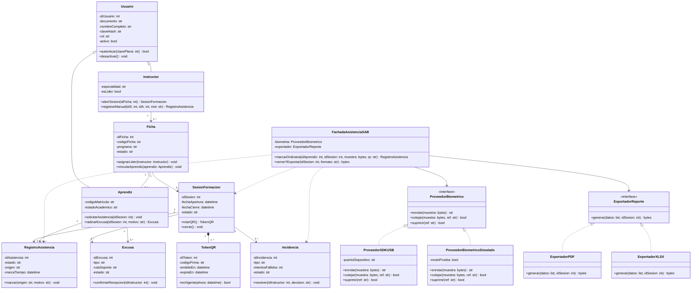

# A2 · Diagrama de Clases de Diseño y A3 · Patrones GoF (SAB)

**Proyecto:** Sistema de Asistencia Biométrica (SAB) · **Referencia:** `SRS-SAB-001`  
**Autor:** `@pascuasjhorman-rgb`  
**Archivos del diagrama:**
- Fuente editable: [`02-diagrama-clases.drawio`](./02-diagrama-clases.drawio)
- Imágenes: [`02-diagrama-clases.png`](./02-diagrama-clases.png) · [`02-diagrama-clases.svg`](./02-diagrama-clases.svg)

---

## 1. Diseño Orientado a Objetos (A2) — Cohesión, Acoplamiento y Polimorfismo

El diagrama contiene **13 clases e interfaces** con atributos tipados, visibilidad (`-` privado, `#` protegido, `+` público), métodos con parámetros y tipos de retorno, multiplicidades en todas las asociaciones y separación estricta de responsabilidades (ninguna clase mezcla UI, lógica de negocio, persistencia y reportes):

- **Herencia («es un»):** `Aprendiz` e `Instructor` heredan de `Usuario` (`-idUsuario: int`, `-documento: str`, `-claveHash: str`, `-estado: str`, `+autenticar(clave: str): bool`).
- **Composición («es parte de», ciclo de vida dependiente):** `SesionFormacion` compone `1..*` `TokenQR` (`*--`); al cerrar o eliminar la sesión, sus tokens QR dejan de existir operativamente.
- **Agregación:** `Ficha` agrega `0..*` `Aprendiz` (mediante vínculo académico; si desaparece una ficha, el usuario aprendiz conserva su historial).
- **Interfaces y Polimorfismo:**
  1. `<<interface>> ProveedorBiometrico` implementada por `ProveedorSDKUSB` y `ProveedorBiometricoSimulado` (2 implementaciones concretas).
  2. `<<interface>> ExportadorReporte` implementada por `ExportadorPDF` y `ExportadorXLSX` (2 implementaciones concretas).

---

## 2. Patrones de Diseño GoF aplicados (A3)

Se aplican **3 patrones GoF distintos** (todos distintos de Singleton):

| Patrón GoF | Problema concreto del caso SAB | Por qué se eligió este patrón | Clases que lo implementan | Qué mejora en mantenibilidad |
|---|---|---|---|---|
| **1. Strategy (Estrategia)** — *Biometría* | El SRS (`R-01`, `RNF-BIO-022`) advierte que el lector biométrico y su SDK aún no están definidos en producción y no todos los equipos de desarrollo/piloto tienen hardware físico conectado. | Desacopla el algoritmo de captura, cotejo y baja biométrica tras una interfaz polimórfica común, permitiendo intercambiar el proveedor real o simulado en tiempo de configuración (`RNF-BIO-019`). | `ProveedorBiometrico` (`<<interface>>`), `ProveedorSDKUSB`, `ProveedorBiometricoSimulado`, usada por `FachadaAsistenciaSAB`. | Si mañana se adquiere otro modelo de lector biométrico, se agrega una nueva clase implementando `ProveedorBiometrico` sin modificar `FachadaAsistenciaSAB` ni `RegistroAsistencia`. |
| **2. Strategy (Estrategia)** — *Reportes* | Al cerrar una sesión (`RF-BIO-045`, `RF-BIO-046`), el instructor debe poder descargar el mismo consolidado en formato **PDF** o **XLSX**. | Encapsula cada algoritmo de serialización de archivos en su propia clase bajo un contrato único `generar(datos, idSesion)`. | `ExportadorReporte` (`<<interface>>`), `ExportadorPDF`, `ExportadorXLSX`, usada por `FachadaAsistenciaSAB`. | Permite incorporar un tercer formato futuro (por ejemplo CSV institucional para SOFIA Plus) sin tocar la lógica de cierre de sesión ni añadir condicionales extensos. |
| **3. Facade (Fachada)** — *Orquestación* | El flujo de marcación ordinaria (`CU-08`, `RF-BIO-024`–`029`) coordina simultáneamente sesión activa, biometría, rotación de QR, regla de 3 intentos, generación de incidencias y registro único. | Ofrece un punto de entrada unificado (`marcarOrdinaria`, `cerrarYExportar`) que oculta la complejidad interna a la capa API/presentación, manteniendo bajo acoplamiento. | `FachadaAsistenciaSAB` coordinando `SesionFormacion`, `TokenQR`, `RegistroAsistencia`, `Incidencia` y las estrategias `ProveedorBiometrico` y `ExportadorReporte`. | Los controladores web no dependen directamente de 6 clases de dominio; cualquier ajuste en el orden de validaciones (huella → QR → duplicado) se cambia en un solo lugar. |
