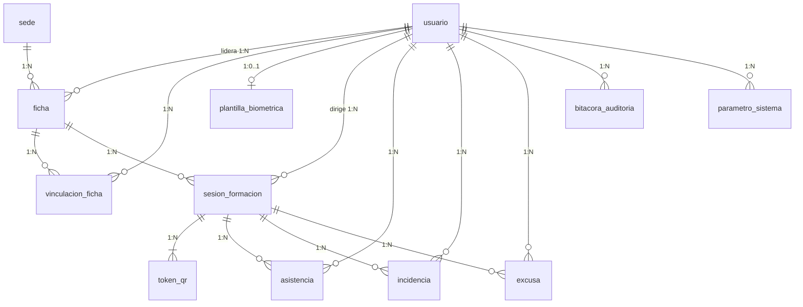

# B1 · Modelo Conceptual y B2 · Modelo Lógico Relacional (SAB)

**Proyecto:** Sistema de Asistencia Biométrica (SAB) · **Referencia:** `SRS-SAB-001`  
**Base reutilizada y ajustada:** MER de análisis de [G1-P2](../01-analysis/03-conceptual-model/04-evidence-learning/G1-P2-sab-asistencia/04-modelo-entidad-relacion.md) *(se aclara que `03-execute/22-week/02-optional-activity/sdaa.mwb` corresponde a un ejercicio previo de ventas y no se reutilizó)*.  
**Autor:** `@pascuasjhorman-rgb`

---

## 1. Modelo Conceptual ajustado al motor relacional (B1)

**Tipo de base de datos seleccionada y justificación:** Relacional (**MariaDB 10.4+ / PostgreSQL**), dado que SAB exige integridad referencial estricta entre sedes, fichas, usuarios y sesiones; restricción única compuesta por `(id_sesion, id_aprendiz)` (`RN-06`); y transacciones ACID para registrar asistencia y bitácora simultáneamente (`RN-12`).

**Entidades conceptuales (11 entidades, cardinalidad mín/máx, verbo y trazabilidad RF):**

| Entidad | Identificador | Atributos principales | Relación (verbo + cardinalidad) | Requisito que soporta |
|---|---|---|---|---|
| `SEDE` | `id_sede` | `nombre_sede`, `ciudad`, `estado` | *contiene* `1..1` a `0..N` `FICHA` | `RF-BIO-006` |
| `USUARIO` | `id_usuario` | `documento`, `correo`, `nombre_completo`, `clave_hash`, `rol`, `estado` | *participa en* `0..N` `VINCULACION_FICHA` | `RF-BIO-001`, `008`, `013` |
| `FICHA` | `id_ficha` | `codigo_ficha`, `programa`, `jornada`, `estado` | *pertenece a* `1..1` `SEDE`; *liderada por* `1..1` `USUARIO` | `RF-BIO-007`, `009` |
| `VINCULACION_FICHA` | `id_vinculacion` | `rol_en_ficha`, `fecha_vinculacion`, `fecha_retiro`, `estado` | Resuelve `N:M` entre `USUARIO` y `FICHA` | `RF-BIO-012`, `015`, `016` |
| `PLANTILLA_BIOMETRICA` | `id_plantilla` | `referencia_protegida`, `acepta_tratamiento`, `fecha_aceptacion`, `estado` | *pertenece a* `1..1` `USUARIO` (`0..1` por usuario) | `RF-BIO-017`, `051`, `052` |
| `SESION_FORMACION` | `id_sesion` | `fecha_apertura`, `fecha_cierre`, `estado_sesion`, `motivo_contingencia` | *abre en* `1..1` `FICHA` | `RF-BIO-018`, `022`, `038` |
| `TOKEN_QR` | `id_token` | `codigo_firma`, `emitido_en`, `expira_en`, `estado_token` | *emite* `1..N` desde `1..1` `SESION_FORMACION` | `RF-BIO-020`, `021`, `026` |
| `ASISTENCIA` | `id_asistencia` | `estado_asistencia`, `origen_registro`, `marca_tiempo`, `motivo_manual` | *registra* `0..N` en `SESION_FORMACION` para `USUARIO` | `RF-BIO-029`, `036`, `037` |
| `INCIDENCIA` | `id_incidencia` | `tipo_incidencia`, `intentos_fallidos`, `estado_resolucion`, `decision` | *genera* `0..N` en `SESION_FORMACION` | `RF-BIO-028`, `031`, `033` |
| `EXCUSA` | `id_excusa` | `tipo_excusa`, `observacion`, `ruta_soporte`, `estado_recepcion` | *radica* `0..N` por `USUARIO` sobre `SESION_FORMACION` | `RF-BIO-040`, `041`, `042` |
| `BITACORA_AUDITORIA` | `id_auditoria` | `entidad_recurso`, `operacion`, `valor_anterior`, `valor_nuevo`, `fecha_evento` | *audita* `0..N` eventos de `USUARIO` | `RF-BIO-050`, `054` |

*(Ver diagrama conceptual completo en [`G1-P2/04-modelo-entidad-relacion.png`](../../../../01-analysis/03-conceptual-model/04-evidence-learning/G1-P2-sab-asistencia/04-modelo-entidad-relacion.png).)*

---

## 2. Cuadro de Reglas de Transformación (Conceptual → Lógico Relacional)

| Regla aplicada | Caso en SAB | Resultado en el Modelo Lógico |
|---|---|---|
| **Relación N:M** → tabla intermedia con PK propia o compuesta | Un `USUARIO` participa en varias `FICHA` y una `FICHA` agrupa varios `USUARIO` | Tabla `vinculacion_ficha(id_vinculacion PK, id_ficha FK, id_usuario FK, rol_en_ficha, fecha_vinculacion, fecha_retiro, estado)` |
| **Relación 1:N** → FK en el lado «muchos» | Una `SEDE` tiene muchas `FICHA`; una `SESION_FORMACION` tiene muchos `TOKEN_QR` | `ficha.id_sede FK`, `sesion_formacion.id_ficha FK`, `token_qr.id_sesion FK`, `asistencia.id_sesion FK` |
| **Relación 1:1 (u opcional 0..1)** → FK con restricción `UNIQUE` | Cada aprendiz tiene como máximo una `PLANTILLA_BIOMETRICA` vigente | `plantilla_biometrica.id_usuario FK UNIQUE` |
| **Generalización (`Usuario` → `Aprendiz`, `Instructor`)** → tabla única con discriminador | `Aprendiz`, `Instructor`, `Coordinador` y `Administrador` comparten documento, correo, hash y estado | Se implementa tabla única `usuario` con columna `rol` (`ENUM` / `CHECK`) y `codigo_matricula` opcional (`NULL` para no aprendices), evitando joins innecesarios en cada login |
| **Regla de unicidad compuesta** → índice único sobre pares de FK | Un aprendiz solo puede tener una asistencia válida por sesión (`RN-06`) | `asistencia` incluye `UNIQUE (id_sesion, id_aprendiz)` |
| **Atributos configurables del sistema** | Parámetros de rotación QR (15 s), ventana (10 s) y máximo de intentos (3) (`RF-BIO-010`) | Tabla `parametro_sistema(clave PK, valor, descripcion, actualizado_por FK, actualizado_en)` |

---

## 3. Modelo Lógico Relacional (12 tablas normalizadas en 3FN)

1. `sede(id_sede PK, nombre_sede UK, ciudad, estado)`
2. `usuario(id_usuario PK, documento UK, correo UK, nombre_completo, clave_hash, rol, codigo_matricula, especialidad, estado, ultimo_acceso)`
3. `ficha(id_ficha PK, id_sede FK, id_lider FK, codigo_ficha UK, programa, jornada, estado)`
4. `vinculacion_ficha(id_vinculacion PK, id_ficha FK, id_usuario FK, rol_en_ficha, fecha_vinculacion, fecha_retiro, estado)`
5. `plantilla_biometrica(id_plantilla PK, id_usuario FK UK, referencia_protegida, acepta_tratamiento, fecha_aceptacion, estado_vigencia, fecha_baja)`
6. `sesion_formacion(id_sesion PK, id_ficha FK, id_instructor FK, fecha_apertura, fecha_cierre, estado_sesion, motivo_contingencia, soporte_contingencia)`
7. `token_qr(id_token PK, id_sesion FK, codigo_firma UK, emitido_en, expira_en, estado_token)`
8. `asistencia(id_asistencia PK, id_sesion FK, id_aprendiz FK, estado_asistencia, origen_registro, marca_tiempo, motivo_manual, registrada_por FK)` *(con `UNIQUE(id_sesion, id_aprendiz)`)*
9. `incidencia(id_incidencia PK, id_sesion FK, id_aprendiz FK, tipo_incidencia, intentos_fallidos, estado_resolucion, decision_resolucion, resuelta_por FK, fecha_resolucion)`
10. `excusa(id_excusa PK, id_aprendiz FK, id_sesion FK, tipo_excusa, observacion, ruta_soporte, estado_recepcion, confirmada_por FK, fecha_confirmacion)`
11. `bitacora_auditoria(id_auditoria PK, id_actor FK, entidad_recurso, id_registro_afectado, operacion, valor_anterior, valor_nuevo, resultado, fecha_evento)`
12. `parametro_sistema(clave_parametro PK, valor_parametro, descripcion, actualizado_por FK, actualizado_en)`
